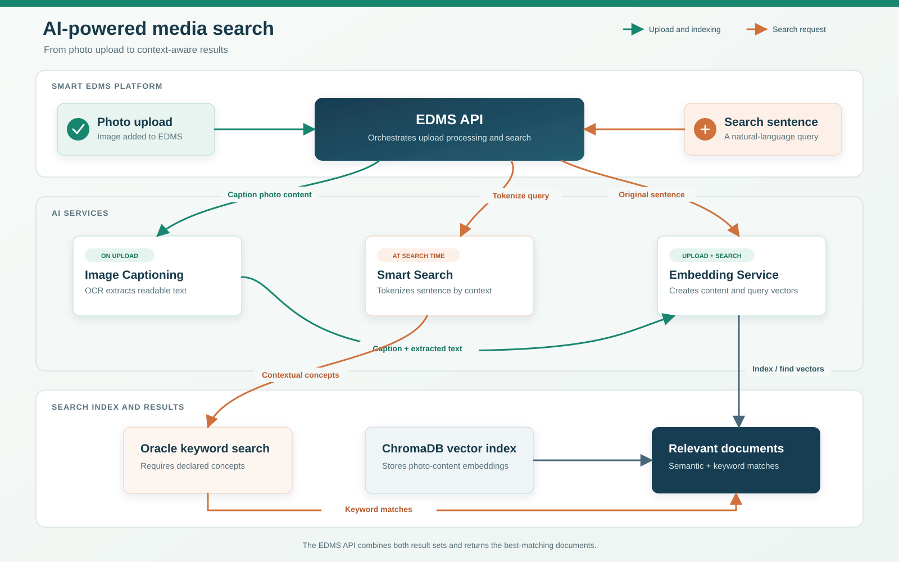

# EDMS Media Frontend

The **EDMS Media Frontend** is the user-facing web application of the **Smart EDMS** ecosystem — a modern Electronic Document Management System for the Roads & Transport Authority (RTA). It is built with **Next.js 16 (App Router)**, **React 19**, **TypeScript**, **Tailwind CSS**, and **TanStack React Query**, and provides a rich, responsive, bilingual (English / Arabic) interface for browsing, searching, uploading, sharing, and AI-analysing documents and media (images, videos, PDFs, Office files) stored in an on-premise OpenText eDOCS Document Management System (DMS).

This frontend never talks to the database or the DMS directly. Instead it routes **every** backend call through a single **Next.js API proxy** (`/api/[...proxy]`) which forwards requests to the **Smart EDMS API** (a FastAPI backend, a.k.a. `EDMS API`), which in turn orchestrates Oracle DB, the SOAP/WSDL DMS server, and a suite of on-premise AI microservices.

> **See also:** the auto-generated code-graph in [`graphify-out/`](./graphify-out) — open `graphify-out/graph.html` in a browser for an interactive dependency graph of this codebase, and read `graphify-out/GRAPH_REPORT.md` for a structural summary (399 nodes · 589 edges · 50 communities).

---

## Table of Contents

- [Architecture Overview](#architecture-overview)
- [Technology Stack](#technology-stack)
- [Features](#features)
- [Project Structure](#project-structure)
- [Environment Variables](#environment-variables)
- [The API Proxy Layer](#the-api-proxy-layer)
- [The API Client (`apiClient`)](#the-api-client-apiclient)
- [State Management & Data Fetching](#state-management--data-fetching)
- [Authentication & Authorization](#authentication--authorization)
- [Internationalisation (i18n) & Theming](#internationalisation-i18n--theming)
- [Core Hooks Reference](#core-hooks-reference)
- [Component Reference](#component-reference)
- [Integration with the EDMS API](#integration-with-the-edms-api)
- [Connected Projects & AI Services](#connected-projects--ai-services)
- [Getting Started](#getting-started)
- [Build & Deployment](#build--deployment)
- [Graphify Code Graph](#graphify-code-graph)

---

## Architecture Overview

```
┌──────────────────────────────────────────────────────────────────────┐
│                    EDMS Media Frontend (this project)                 │
│                    Next.js 16 · React 19 · TypeScript                 │
│  ┌────────────┐   ┌──────────────┐   ┌────────────────────────────┐  │
│  │  Browser    │──►│  React UI    │──►│  TanStack React Query      │  │
│  │  (client)   │   │  Components  │   │  (cache / mutations)       │  │
│  └────────────┘   └──────────────┘   └─────────────┬──────────────┘  │
│                       │                              │                │
│                       │          ┌───────────────────▼───────────┐   │
│                       │          │  apiClient (lib/apiClient.ts)  │   │
│                       │          │  retry · 401-redirect · JSON   │   │
│                       │          └───────────────┬───────────────┘   │
│                       │                          │ /api/*             │
│                       │          ┌───────────────▼───────────────┐   │
│                       │          │  Next.js Route Handler         │   │
│                       │          │  app/api/[...proxy]/route.ts   │   │
│                       │          │  (server-side proxy + retry)   │   │
│                       └──────────┴───────────────┬───────────────┘   │
└──────────────────────────────────────────────────┼──────────────────┘
                                                   │ HTTP (same-origin)
                                                   ▼
┌──────────────────────────────────────────────────────────────────────┐
│              Smart EDMS API  (FastAPI · port 5000)                    │
│              ../EDMS API/app.py                                       │
│   Routes ► Services ► Database Layer                                  │
│      │           │              ├─► Oracle DB (PROFILE, TAGGING_QUEUE)│
│      │           │              ├─► SQLite (processing_queue.sqlite3)│
│      │           │              ├─► ChromaDB (vector search)         │
│      │           │              └─► SOAP/WSDL DMS (OpenText eDOCS)    │
│      │           │                                                    │
│      │           └─► AI microservices ─┬─ Image Captioning   :5001   │
│      │                                  ├─ Face Recognition  :5002   │
│      │                                  ├─ Embedding Service :5003   │
│      │                                  ├─ OCR               :5004   │
│      │                                  ├─ Translator/Rephr. :5005   │
│      │                                  ├─ Smart Search      :5006   │
│      │                                  └─ Video Summarizer  :5008   │
│      │                                                                │

---

## Technology Stack

| Layer | Technology |
|---|---|
| Framework | **Next.js 16** (App Router, React Server Components + Client Components) |
| UI | **React 19**, **TypeScript 5.9** |
| Styling | **Tailwind CSS 3.4**, `@tailwindcss/aspect-ratio`, dark mode (`class` strategy) |
| Data fetching / cache | **TanStack React Query 5** (`@tanstack/react-query`) |
| Forms & inputs | `react-select`, `react-select-async-paginate`, `react-datepicker` |
| Document rendering | `docx-preview` (Word), `xlsx` (Excel), `exifreader` (EXIF), `jszip` |
| Error handling | `react-error-boundary` + custom `QueryErrorBoundary` |
| Build tooling | `env-cmd` (per-environment `.env`), `archiver` (bundling script) |
| Linting | ESLint (`eslint-config-next`) |

---

## Features

### Browsing & Navigation
- **Recently Added** grid (`/`) — paginated, sorted by date descending.
- **Favorites** view (`/favorites`) — per-user favourited documents.
- **Folders** explorer (`/folders`) — navigates the DMS folder hierarchy with breadcrumbs, subfolders, and item counts. Supports standard media folders (Images / Videos / Files) and arbitrary DMS folder trees.
- **Document grid & list views** with skeletons, infinite-scroll select components, and responsive layouts.
- **Pagination** (First / Prev / Next / Last) with `keepPreviousData` to avoid flicker.

### Search & Filtering (Advanced Filters)
- **Free-text search** — runs the original sentence through semantic vector search and sends Smart Search concepts to SQL keyword search; the API fuses their ranked candidates and applies filters.
- **Person filter** — multi-select with `any` / `all` condition logic.
- **Tag filter** — multi-select with shortlist support.
- **Date-range filter** — from/to date-time pickers.
- **Year filter** — multi-select.
- **Media-type filter** — image / video / pdf.

### Document Viewing (Type-Specific Modals)
Every media type has a dedicated full-screen modal viewer with a navigation bar (prev/next within the current page):
- **ImageModal** — high-resolution image viewer with zoom, AI face-analysis overlay, and metadata editing.
- **VideoModal** — video streaming with Range support, playback controls.
- **PdfModal** — PDF rendering (iframe-friendly backend `/api/pdf/` route).
- **WordModal** — `.docx` rendering via `docx-preview`.
- **ExcelModal** — `.xlsx` rendering via `xlsx`, with date parsing helpers.
- **PowerPointModal** — PowerPoint preview.
- **FileModal** — generic file download / preview.

### AI-Powered Analysis
- **Face Analysis** — `Analyze for Faces` opens the image in the ImageModal, calls the Face Recognition service, draws bounding boxes around detected faces, and lets the user:
  - **Recognise** faces against the known-faces database.
  - **Enrol (Add Face)** a new person — saves the cropped face and computes an embedding.
  - **Add Person** to the abstract metadata.
  - **Update Abstract** with newly identified names (auto-refreshes the grid).
- **Rerun Analysis** — reprocess a single document through the full AI pipeline.
- **Process Uploaded Documents** — bulk-trigger AI processing for a set of docnumbers.
- **Processing Status** — live polling of which documents are currently being processed.
- **Review Status** — per-document `pending` / `ready_for_review` / `verified` badges with optimistic toggling (Editors can mark verified / not-analysed; Viewers see read-only badges).

### Upload
- **Upload Modal** — drag-and-drop multi-file upload with:
  - Per-file name, abstract, and date-taken fields.
  - Real-time progress bar (XHR `upload.onprogress`).
  - **Idempotency-Key** header to prevent duplicates on retry.
  - Automatic retry (2 attempts) with exponential backoff on transient failures.
  - **2 GB** max file size, **10-minute** timeout.
  - Quota validation and display (`useQuota`).
- **Folder Upload Modal** — upload into a specific DMS folder.

### Document Metadata Management
- Edit document **name**, **abstract**, and **date taken**.
- **Tags** — add / remove tags (EN + AR), toggle shortlist, with optimistic updates and rollback on error.
- **Person tagging** — link persons to documents.
- **Move** documents between folders.
- **Delete** documents (restores user quota).

### Security & Sharing
- **Security Modal** — per-document trustee management (set DMS ACL trustees, enable/disable security).
- **Share Modal** — generate shareable links:
  - **Open** (any `@rta.ae` email) or **Restricted** (specific email(s)).
  - Expiry date, single or multiple target emails.
  - Backend sends OTP-verified links via SMTP; downloads are watermarked with the viewer's email.

### Admin Panel (`/admin`)
Role-based admin UI (requires admin allowlist):
- **Processing Queue / Worker controls** — view queue metrics (queued / in-progress / completed / failed), pause / resume / drain the worker, retry failed jobs, purge old completed jobs.
- **Tab Permissions** — per-user, per-tab read/write permission toggles.

### System & UX
- **Bilingual** — full English (`en.json`) and Arabic (`ar.json`) translations; RTL/LTR is applied (note: `dir` is currently forced to `ltr` in layout).
- **Dark / Light theme** — persisted in `localStorage`, applied before hydration to avoid flash.
- **Toast notifications** — global toast bridge (`toastBridge.ts`) wired into React Query mutation errors.
- **Global content protection** — disabled context menu, image dragging, Ctrl+S.
- **Error boundaries** — `QueryErrorBoundary` wraps the app; per-query error logging.
- **Lazy-loaded modals** — code-splitting for heavy components.
- **Quota badges & pie chart** — visual quota usage.

---

## Project Structure

```
EDMS Media frontend/
├── src/
│   ├── app/                         # Next.js App Router
│   │   ├── layout.tsx               # Root layout: theme/lang scripts, providers, GlobalSecurity
│   │   ├── page.tsx                 # Home ("/") → MainDashboard (recent)
│   │   ├── providers.tsx            # QueryClient + QueryErrorBoundary setup
│   │   ├── globals.css              # Tailwind + global styles
│   │   ├── admin/                   # Admin panel (layout + page + components)
│   │   ├── api/
│   │   │   └── [...proxy]/route.ts  # ★ Server-side proxy to EDMS API & Face Recog
│   │   ├── components/              # ~40 React components (see Component Reference)
│   │   ├── context/                 # ToastContext, UserContext
│   │   ├── favorites/page.tsx       # /favorites route
│   │   ├── folders/page.tsx         # /folders route
│   │   ├── hooks/useTranslations.ts # i18n hook
│   │   ├── login/page.tsx           # login route
│   │   └── styles/                  # additional CSS
│   ├── hooks/                       # ~28 TanStack Query hooks (see Core Hooks)
│   ├── interfaces/                  # TypeScript interfaces & props
│   ├── lib/
│   │   ├── apiClient.ts             # ★ Centralised fetch client (retry, 401, JSON)
│   │   └── toastBridge.ts           # Decoupled toast emitter
│   ├── locales/                     # ar.json, en.json (i18n strings)
│   ├── models/                      # Document, PersonOption, User, EventItem models
│   └── types/                       # ambient type declarations
├── graphify-out/                    # Auto-generated code graph (see Graphify section)
├── public/                          # static assets
├── create-bundle.js                 # packaging/bundling script (archiver)
├── next.config.mjs
├── tailwind.config.ts
├── tsconfig.json
├── web.config                       # IIS deployment config

---

## Environment Variables

### `.env.local` (development)

```bash
# The Smart EDMS API (FastAPI) base URL — proxied through /api/*
NEXT_PUBLIC_FLASK_API_URL=http://localhost:5000

# Face Recognition service URL (used by the proxy for face-analysis routes)
FACE_RECOG_URL=http://10.100.61.225:5002

# Proxy timeouts (ms)
API_PROXY_TIMEOUT_MS=30000       # default for most routes
AUTH_PROXY_TIMEOUT_MS=10000      # /auth/* routes (faster timeout)

NEXT_TELEMETRY_DISABLED=1
```

### `.env.production`

```bash
NEXT_PUBLIC_FLASK_API_URL=http://localhost:809      # IIS port for EDMS API in prod
FACE_RECOG_URL=http://localhost:5002
API_PROXY_TIMEOUT_MS=30000
AUTH_PROXY_TIMEOUT_MS=10000
NEXT_TELEMETRY_DISABLED=1
```

> `NEXT_PUBLIC_FLASK_API_URL` is read **server-side only** by the proxy route. `FACE_RECOG_URL` is also server-side only. Neither is exposed to the browser — all browser requests go to the same-origin `/api/*`.

---

## The API Proxy Layer

**File:** `src/app/api/[...proxy]/route.ts`

This is the single chokepoint through which all client → backend traffic flows. It is a Next.js Route Handler (server-side) that supports `GET`, `POST`, `PUT`, `DELETE`.

### How it works
1. Strips the `/api` prefix from the pathname (e.g. `/api/documents` → `/documents`).
2. Determines the **target backend**:
   - **Face-recognition routes** (`/analyze_image`, `/add_face`, `/recognize_faces`, `/analyze_image_stream`) → forwarded to `FACE_RECOG_URL` (the Face Recognition service, port 5002).
   - **All other routes** → forwarded to `NEXT_PUBLIC_FLASK_API_URL` (the EDMS API, port 5000).
3. Picks a **timeout** based on the path:
   - `/auth/*` → `AUTH_PROXY_TIMEOUT_MS` (10 s).
   - Long routes (`/upload_document`, `/analyze_image`, `/add_face`, `/recognize_faces`, `/analyze_image_stream`) → **600 000 ms (10 min)** for large uploads / AI processing.
   - Default → `API_PROXY_TIMEOUT_MS` (30 s).
4. Streams the request body to the backend with `duplex: 'half'` and `cache: 'no-store'`, using an `AbortController` for the timeout.
5. **Server-side retry** (2 attempts) on `502/503/504` (for `GET/HEAD`) or pure network errors (for mutations — only when no response was received, to avoid duplicates).
6. Preserves all `Set-Cookie` headers (including multiple) from the backend.
7. Normalises FastAPI error responses (`detail` → `error`) for the client.

This design means the browser only ever makes same-origin requests, cookies flow through automatically, and the backend URLs/ports are never exposed.

---

## The API Client (`apiClient`)

**File:** `src/lib/apiClient.ts`

A thin wrapper around `fetch` used by every hook. It provides:

| Feature | Detail |
|---|---|
| `ApiError` class | Carries `status` + `data` for structured error handling. |
| **Auto 401 → /login** | On 401, redirects to `/login?redirect=<current-path>` (skips if already on `/login`). |
| **Automatic retry** | Exponential backoff (300 ms → 600 ms → 1200 ms …, capped at 5 s, with jitter). Retries on network errors and `408/429/500/502/503/504`. `GET/HEAD/OPTIONS` retry up to 3×; `POST/PUT/DELETE/PATCH` retry up to 1×. Respects `Retry-After` on `429`. |
| **AbortSignal support** | Hooks can cancel in-flight requests. |
| `credentials: 'include'` | Sends session cookies on every request. |
| `DEFAULT_HEADERS` | Adds `X-App-Source: edms-media` to every request. |
| Methods | `get`, `post`, `put`, `delete`, and `raw` (for blob/stream downloads — no JSON parsing, still retries + 401-redirects). |
| FormData support | `post` auto-detects `FormData` and skips `Content-Type: application/json`. |

---

## State Management & Data Fetching

The app uses **TanStack React Query 5** as its sole client-side state/cache layer (no Redux/Zustand). Configuration in `providers.tsx`:

- **`staleTime`:** 1 minute (queries).
- **`gcTime`:** 5 minutes.
- **Query retry:** up to 2 attempts, but **never** on 4xx errors.
- **`refetchOnWindowFocus`:** disabled.

---

## Authentication & Authorization

- **`useAuth`** hook — `GET /api/auth/user` (cached 5 min), `POST /api/auth/login`, `POST /api/auth/logout` (clears the entire query cache).
- **`UserContext`** — wraps `useAuth` and derives:
  - `currentLang` / `currentTheme` (synced to `localStorage` + `<html>` attributes).
  - `allowedSections` — which sidebar tabs the user can **read** (from `tab_permissions.can_read`). `favorites` is merged with `recent`.
  - `writableSections` — which tabs the user can **write** to (from `tab_permissions.can_write`). The global `security_level` (Editor/Viewer) does **not** control write access — each tab's `can_write` does, independently.
- **Route guard** — `MainDashboard` redirects users away from sections they lack permission for.
- **Admin access** — checked via `GET /api/admin/check-access` (admin allowlist on the backend).

---

## Internationalisation (i18n) & Theming

- **Translation files:** `src/locales/en.json` and `src/locales/ar.json` (~150+ keys each).
- **`useTranslations` hook** — returns a `t(key, params?)` function with `{{param}}` interpolation.
- **Language** — persisted in `localStorage('lang')`; applied to `document.documentElement.lang` before hydration (inlined script in `layout.tsx`) to avoid mismatch.

---

## Core Hooks Reference

All hooks live in `src/hooks/` and use TanStack Query. Each encapsulates a domain.

| Hook | Purpose | Backend endpoints |
|---|---|---|
| `useAuth` | Login / logout / current user | `/api/auth/*` |
| `useDocuments` | Paginated document list with all filters | `/api/documents`, `/api/favorites` |
| `useDocumentContent` | Fetch raw document bytes (blob/text/arraybuffer) | `/api/document/{id}` (via `apiClient.raw`) |
| `useDocumentMetadata` | Fetch / update document metadata | `/api/document/{id}/metadata` |
| `useDocumentModals` | State for type-specific viewers (which modal is open) | — |
| `useDocumentMutations` | Move / delete / update documents | `/api/documents/*` |
| `useDocumentGroups` | Document groupings | `/api/document-groups` |
| `useDocumentTagsBatch` | Batch-fetch tags for up to 50 docs | `/api/tags/batch` |
| `useFolderContents` | DMS folder tree navigation + search | `/api/folders` |
| `useFolderContentSearch` | In-folder search | `/api/folders/search` |
| `useFolderPreviews` | Folder thumbnail/preview aggregation | `/api/folders/previews` |
| `useFolderProcessingStatus` | Per-folder processing progress | `/api/folders/processing-status` |
| `useFolderProcessingSummary` | Folder-level processing summary | `/api/folders/processing-summary` |
| `useFolderMutations` | Create / rename / move / delete folders | `/api/folders/*` |
| `useMoveModalFolders` | Folder picker for the move modal | `/api/folders` |
| `usePersons` | Person list / search (for face & person filters) | `/api/persons` |
| `useTags` | All tags + per-doc tags; add/remove/shortlist (optimistic) | `/api/tags`, `/api/tags/{id}`, `/api/tags/shortlist` |
| `useAnalysis` | Face analysis: analyze image, add face, add person, update abstract | `/api/analyze_image`, `/api/add_face`, `/api/add_person`, `/api/update_abstract` |
| `useReviewStatus` | Review-status badges (optimistic) for docs & folders | `/api/documents/review-status`, `/api/documents/{id}/review-status`, `/api/folders/{id}/review-status` |
| `useProcessingStatus` | Live processing-status poll | `/api/processing_status` |
| `useSystemOperations` | Clear cache, process uploaded docs, rerun analysis | `/api/clear_cache`, `/api/process_uploaded_documents`, `/api/documents/{id}/rerun-analysis` |
| `useSecurity` | Trustees, update security, generate share link | `/api/document/{id}/trustees`, `/api/document/{id}/security`, `/api/share/generate` |
| `useUpload` | Multi-file upload (XHR, progress, idempotency, retry) | `/api/upload_document` |
| `useQuota` | User quota (remaining / total) | `/api/auth/user` |
| `useDownload` | Blob download (with watermark) | `/api/document/{id}/download` |
| `useUserPreferences` | Language / theme / view-mode preferences | `/api/auth/user` |

---

## Component Reference

Key components in `src/app/components/`:

| Component | Role |
|---|---|
| `MainDashboard` | Top-level orchestrator: section state, filters, pagination, modals. |
| `Header` | Top bar: search, language/theme toggles, user menu, quota badge. |
| `Sidebar` | Section navigation (Recent / Favorites / Folders) + admin link. |
| `FilterBar` / `AdvancedFilters` | Search + person + tag + date + year + media-type filters. |
| `DocumentList` / `DocumentItem` / `DocumentItemSkeleton` | Grid/list rendering with skeletons. |
| `DocumentModals` | Dispatcher that opens the correct type-specific modal. |
| `ImageModal` / `VideoModal` / `PdfModal` / `WordModal` / `ExcelModal` / `PowerPointModal` / `FileModal` | Type-specific viewers. |
| `ModalNavigationBar` | Prev/next navigation within a page inside any modal. |
| `PersonSelector` / `InfiniteSelect` | Async-paginated multi-select (persons, tags, folders). |
| `Folders` / `FolderIcon` / `FolderSkeleton` / `FolderUploadModal` / `CreateFolderModal` | Folder tree UI. |
| `UploadModal` | Drag-and-drop multi-file upload with progress. |
| `SecurityModal` / `ShareModal` | Trustee management & share-link generation. |
| `HistoryModal` | Document history viewer. |
| `ClearCacheModal` | Cache-clearing dialog. |
| `AnalysisView` | AI analysis results / face-analysis overlay. |
| `ReviewStatusBadge` / `QuotaAccessBadge` / `QuotaPieChart` | Status badges & charts. |
| `LoadingButton` | Reusable button with loading state (a "god node" — 14 edges). |
| `ErrorBoundary` / `QueryErrorBoundary` | Error handling. |
| `GlobalSecurity` | Disables right-click, drag, Ctrl+S app-wide. |
| `DateRangePicker` / `CollapsibleSection` / `Pagination` / `Spinner` / `ReadOnlyTagDisplay` | Reusable UI primitives. |


---

## Integration with the EDMS API

The backend is the **Smart EDMS API** (`../EDMS API/`), a **FastAPI** application (`app.py`) running on port 5000 (IIS port 809 in production). It is the central middleware that this frontend depends on. Below is a detailed technical summary of what it provides; see `../EDMS API/readme.md` for the full reference.

### What the EDMS API does
- **Authentication & sessions** — login/logout, session cookies, per-user language/theme/quota/view-mode, tab permissions.
- **Documents** — paginated fetch with 10+ filter dimensions, **hybrid search** (ChromaDB vector search + Oracle `LIKE` keyword search, merged), metadata updates, processing-status tracking.
- **Media** — DMS media streaming (sync + async), thumbnail generation (image / PDF / video), EXIF date extraction, media-type detection, app-bucket caching.
- **Folders** — DMS folder CRUD, navigation, breadcrumbs, move/rename/delete.
- **Tags & Persons** — full tag lifecycle (EN+AR keywords), batch fetch, shortlist, security-level-aware filtering; person linking.
- **Favorites** — per-user favorites.
- **Sharing** — share-link CRUD, **OTP verification** (6-digit code via SMTP), open/restricted modes, folder-share hierarchy validation, **watermarked downloads** (Pillow for images, PyMuPDF for PDFs, FFmpeg/MoviePy for videos).
- **Admin** — user management, processing-queue controls, tab permissions.

### AI Processing Pipeline (backend)
When a document is processed (on upload, on bulk "process", or on "rerun analysis"), the EDMS API's `processor.py` (run by the standalone `worker.py`) orchestrates the AI microservices:



At upload, searchable photo content (such as its caption or extracted text) is embedded and stored in ChromaDB. At search time, the original sentence is embedded unchanged while Smart Search extracts terms for keyword candidates. The EDMS API combines both ranked lists with reciprocal-rank fusion (RRF) before applying filters.

**Preparation (non-AI):**
1. The worker fetches the document binary from the DMS via the SOAP/WSDL client and determines its media type.

**AI analysis steps:**
2. **Image Captioning** (port 5001) — generates a natural-language caption + tags.
3. **OCR** (port 5004) — extracts text from images/PDFs.
4. **Face Recognition** (port 5002) — detects & recognises faces; enrolls new faces.
5. **Video Summarization** (port 5008) — for videos: object/face detection + audio transcription → context summary.
6. **Translation/Rephrasing** (port 5005) — cleans/enhances extracted text.
7. **Embedding** (port 5003) — converts searchable photo content (caption, extracted text, and abstract) into a vector and upserts it into **ChromaDB** during upload/processing; the service also embeds search text for semantic queries.
8. **Smart Search** (port 5006) — at query time, extracts context-relevant keyword terms; the original sentence is embedded separately for semantic retrieval.

**Persistence:**
9. Writes results (abstract, tags, persons, processing status) back to **Oracle** (`PROFILE` table) and marks the job complete in the **SQLite queue**.

### Background Worker & Queue
- A **SQLite** queue (`processing_queue.sqlite3`) tracks jobs: `queued → in_progress → completed | failed`.
- `worker.py` is a **standalone process** (separate from the FastAPI server) that polls the queue, claims up to 3 jobs/cycle, and processes each with a timeout (`PROCESSING_TASK_TIMEOUT_SECONDS`, default 300 s).
- The admin UI (this frontend) controls the worker: pause / resume / drain, retry failed, purge completed.
- **Multi-node leader election**: in load-balanced deployments, nodes negotiate via a lease file on a shared folder (`WORKER_ROLE=auto|leader|follower`) so only one node runs background work.

### Data Stores
| Store | Role |
|---|---|
| **Oracle DB** | Source of truth — `PROFILE` (document metadata), `TAGGING_QUEUE` (processing candidates), `PEOPLE`/`PEOPLEGROUPS` (users), security levels, favorites, events, share links. |
| **SQLite** | Local durable processing queue + worker-mode audit + idempotency keys. |
| **ChromaDB** | Vector store (`edms_documents` collection) for semantic search; embeddings from the Embedding Service. |
| **DMS (OpenText eDOCS)** | The actual document binaries, accessed via SOAP/WSDL. |
| **Shared file cache** | Thumbnails, video cache, download cache (on a shared UNC path in multi-node setups). |

### EDMS API environment (key variables the frontend indirectly depends on)
The EDMS API `.env` wires up all AI services:
```bash
CAPTIONING_API_URL="http://localhost:5001"
FACE_API_URL="http://localhost:5002"
EMBEDDING_API_URL="http://localhost:5003/"
OCR_API_URL="http://localhost:5004"
TRANSLATOR_REPHRASER_API_URL="http://localhost:5005/"
SMART_SEARCH_API_URL="http://localhost:5006/"
VIDEO_SUMMARIZER_API_URL="http://localhost:5008/"
FRONTEND_URL="http://localhost:3000"
# + Oracle DB, DMS SOAP, SMTP, shared cache paths, leader-election config
```

---

## Connected Projects & AI Services

This frontend is one node in a larger `d:\projects\new EDMS py\` ecosystem. Every project below is connected, directly or indirectly. Here is a detailed breakdown.

### AI Microservices (called by the EDMS API)

| Service | Project folder | Port | Stack / Model | What it does |
|---|---|---|---|---|
| **Image Captioning** | `Image Captioning py` | 5001 | Flask + **Ollama** (`gemma3:12b` / `llava`) multimodal LLM (or **GovAI** `qwen3-vl-30b`) | Takes an image, returns a JSON `{ caption, tags }`. Single multimodal model replaces multiple specialised models. 100% local/offline. |
| **Face Recognition** | `Face Recognition py` | 5002 | FastAPI + **PIL** (image manipulation) → proxies ML to **Dataiku Model API** (VGG-Face + RetinaFace) | **Gateway** for face analysis. Crops faces, generates thumbnails, draws bounding boxes, stores face images in `known_faces_db/`. **Delegates all ML inference** (detection, recognition, embedding) to the Dataiku Model API over HTTP. Endpoints: `/api/analyze_image`, `/api/analyze_image_stream`, `/api/add_face`, `/api/recognize_faces`. |
| **Embedding Service** | `Embedding Service` | 5003 | FastAPI + **GovAI API** (`qwen3-embedding-8b`) | Converts text → vector via `POST /embed`. Powers ChromaDB semantic search. The EDMS API's `vector_client.py` calls this to upsert/query document abstract embeddings. |
| **OCR** | `OCR py` | 5004 | Flask + **EasyOCR** (PyTorch) + **Ollama Gemma3:12b** (text cleanup) / **GovAI** `qwen3-vl-30b` | Hybrid multilingual (EN/AR) OCR. Searchable PDFs → PyMuPDF direct extraction; scanned PDFs/images → EasyOCR → Gemma cleanup. Endpoints: `/ocr`, `/translate_image_stream`, `/process_pdf`, `/process_pdf_stream`. |
| **Translator / Rephraser** | `Translator Rephraser py` | 5005 | Flask + **Gemma** (HuggingFace Transformers) | Auto-detect EN↔AR translation, contextual rephrasing, on-demand alternatives, live streaming response, cancellable. Used to clean/enhance OCR text and abstracts. |
| **Smart Search** | `Smart Search Service` | 5006 | FastAPI + **GovAI API** (`qwen3-235b-fp16`) | Turns a free-text search sentence into logical **tokens** (key nouns/entities/concepts) via `POST /tokenize`. Auto-detects language, corrects spelling, removes stop words. Tokens enrich SQL `LIKE` keyword candidates; the original sentence is embedded independently. |
| **Video Summarizer** | `Video Context Summarizer` | 5008 | Flask + **Whisper** (audio transcription) + **YOLO** (object detection) + **DeepFace** (face detection) + `ffmpeg` | Generates a context summary for video files using strategic sampling of key frames + audio chunks. Fully offline after model download. |
| **Dataiku Model API** | `Dataiku Model API` | 13000 | **Dataiku** hosted model (VGG-Face + RetinaFace) | The actual ML inference engine for face detection/recognition. Holds `embeddings.json` (vectors only — no images). Called exclusively by the Face Recognition gateway. Uses an internal self-signed certificate (`DATAIKU_VERIFY_SSL=false` in dev). |

### Backend & Infrastructure

| Project | Role |
|---|---|
| **EDMS API** (`../EDMS API`) | The FastAPI middleware backend. **This frontend's primary dependency.** See [Integration with the EDMS API](#integration-with-the-edms-api). |
| **Smart EDMS** | Appears to be the umbrella/legacy full-stack app (largest project). |
| **Smart EDMS POC** | Proof-of-concept variant. |

### Automation Jobs & Crawlers

| Project | Role |
|---|---|
| **EDMS Crawler Service py** | A scheduled service that periodically calls the EDMS API's `/process-batch` endpoint to enqueue newly-crawled documents for AI processing. Logs show it polls on a timer and reports `processed_count`. |
| **EDMS Crawler Task py** | The task definition / scheduler trigger for the crawler. |

### External APIs
- **GovAI API** (`https://llmapi.govai.ae/...`) — government-hosted LLM API used by the Embedding Service (`qwen3-embedding-8b`), Smart Search (`qwen3-235b-fp16`), and as an alternative backend for OCR/Image Captioning (`qwen3-vl-30b`).
- **Ollama** (local, `http://localhost:11434`) — local LLM runtime used by Image Captioning and OCR for `gemma3:12b`.

### Request flow example: "Analyze image for faces"
```
Browser (ImageModal)
  └─► POST /api/analyze_image_stream  (same-origin, via apiClient)
        └─► Next.js proxy (route.ts)  [10-min timeout, no retry on mutation]
              └─► Face Recognition Service (:5002) /api/analyze_image_stream
                    └─► Base64-encode → Dataiku Model API (:13000) /detect_faces
                    └─► Crop faces locally (PIL)
                    └─► Dataiku /recognize_faces  (returns matched names)
                    └─► Draw bounding boxes → processed_image (base64)
                    └─► Return { processed_image, faces[] } to browser
```

### Request flow example: "Search documents"
```
Browser (FilterBar search)
  └─► useDocuments → GET /api/documents?search=...&page=1  (via apiClient)
        └─► Next.js proxy → EDMS API (:5000) /api/documents
            ├─► Smart Search (:5006) /tokenize → keyword concepts
            │     └─► Oracle keyword candidates
            ├─► Embedding Service (:5003) /embed (original sentence)
            │     └─► ChromaDB ranked vector candidates
            └─► RRF merge + filters → paginated documents
```

---

## Getting Started

### Prerequisites
- **Node.js** 18+ (Next.js 16 requirement).
- The **Smart EDMS API** running on `http://localhost:5000` (see `../EDMS API/readme.md`).
- The **Face Recognition service** running (see `../Face Recognition py/readme.md`).
- (For full AI features) all AI microservices running on their respective ports — see [Connected Projects & AI Services](#connected-projects--ai-services).

### Install & run (development)

```bash
# from this project directory
npm install
npm run dev
```

Open **http://localhost:3000**. You will be redirected to `/login` if not authenticated.

### Production build

```bash
# Uses .env.production via env-cmd
npm run build
npm start
```

The `build` script runs `env-cmd -f .env.production next build`, which injects production env vars at build time.

---

## Build & Deployment

- **IIS deployment:** a `web.config` is included for hosting under IIS (the RTA production environment). The EDMS API and all AI services also ship their own `web.config` files using IIS `httpPlatformHandler`.
- **Bundling:** `npm run bundle` runs `create-bundle.js`, which uses `archiver` to package the app (excluding `node_modules`, `.next`, etc.) into a deployable zip.
- **`files to install/`** — contains offline-install artifacts (npm package tarballs) for air-gapped deployment.
- **Telemetry:** Next.js telemetry is disabled (`NEXT_TELEMETRY_DISABLED=1`).

---

## Graphify Code Graph

This repository includes a [`graphify-out/`](./graphify-out) directory — an auto-generated, interactive **code knowledge graph** produced by the Graphify tool.

### What's in it
| File | Purpose |
|---|---|
| `graph.html` | **Interactive vis.js network** — open in a browser to explore every file, function, and import relationship. Nodes are coloured by community (module cluster); node size = degree (number of connections). |
| `graph.json` | The raw graph data (399 nodes, 589 edges) in machine-readable form. |
| `GRAPH_REPORT.md` | A structural report: corpus stats, community hubs, "god nodes" (most-connected abstractions), surprising cross-community connections, knowledge gaps, and suggested questions. |
| `manifest.json` | File-level manifest with hashes + timestamps (used to detect staleness). |
| `cache/` | Cached AST extractions (versioned by graphify v0.8.38). |

### Key findings from the graph (as of commit `2dea82ee`)
- **399 nodes · 589 edges · 50 communities** (17 significant, 33 thin).
- **Extraction: 100% EXTRACTED** (0% inferred/ambiguous) — the graph is purely AST-derived, no LLM guessing.
- **God nodes (core abstractions):** `Document` (18 edges), `apiClient` (14), `LoadingButton` (14), `Folders()` (12), `useDocumentMutations()` (12), `FolderItem` (9), `EnhancedModalProps` (9), `proxyHandler()` (9), `useDownload` (9), `useFocusTrap` (8).
- **Cross-community bridges:** `LoadingButton` and `Document` have high betweenness centrality — they connect many otherwise-separate modules.
- **Knowledge gaps:** 179 weakly-connected nodes (e.g. `FilterBarProps`, `CreateFolderModal`, `HistoryModal`, `SecurityModal`, `ShareModal`) — possible documentation gaps or missing edges.
- **To refresh:** run `graphify update .` after code changes (no API cost).

### How to use it
1. Open `graphify-out/graph.html` in a browser.
2. Hover/click nodes to see their source file and connections.
3. Use the legend (top-right) to filter by community.
4. Read `GRAPH_REPORT.md` for a guided tour of the architecture and suggested exploration questions.

---

## License

Internal RTA project. Not publicly licensed.
